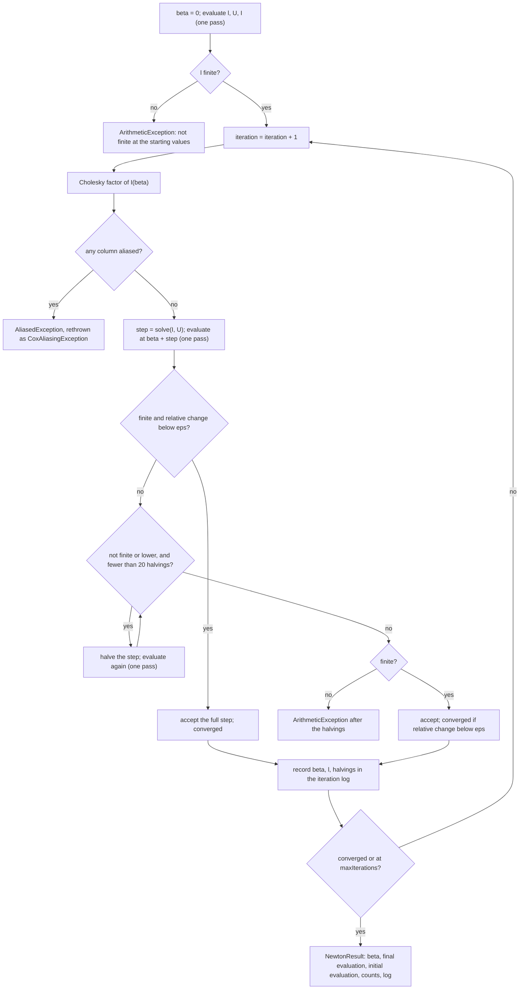

# 3. Numerical optimization and statistical inference

[Tutorial home](README.md) · previous: [2. Partial likelihood and ties](02-partial-likelihood-and-ties.md) ·
next: [4. From mathematics to code](04-from-mathematics-to-code.md)

Chapter 2 gave ℓ(β), U(β) and I(β). This chapter covers how pprof_spark finds β̂ (Newton–Raphson
with step halving), how that can fail, and everything computed from β̂: covariance, Wald tests and
intervals, likelihood-ratio and score tests, robust variance, the baseline hazard, predictions and
residuals. Numbers quoted for tiny-ties come from the [probe](probe/README.md), which calls the
real `Newton.maximize` with the real kernel; they agree with R's stored results to about 1e-15.

## 3.1 Newton–Raphson

**Theory.** Near the current β, approximate ℓ by its second-order Taylor expansion:

```math
\ell(\beta + \Delta) \approx \ell(\beta) + U(\beta)^{\top}\Delta - \tfrac12\,\Delta^{\top} I(\beta)\,\Delta .
```

Maximizing the right-hand side over Δ gives the **Newton step**

```math
\Delta = I(\beta)^{-1}\,U(\beta), \qquad \beta \leftarrow \beta + \Delta .
```

Because ℓ is concave and smooth (chapter 2), Newton's method converges quickly from β = 0 in almost
all practical cases, and near the optimum it converges **quadratically**: the error is roughly
squared at each step. With p between 1 and a few hundred, solving the p × p system is negligible next
to computing U and I, which needs a pass over all n rows. That trade-off is the whole design: a few
expensive distributed passes, each followed by a cheap solve on the driver.

**The tiny-ties iterations (Breslow, default options):**

| k | βₖ | ℓ(βₖ) | Step | Relative change in ℓ | Halvings |
|---:|---|---|---|---|---:|
| 0 | 0 | −9.4163784553874520 | — | — | — |
| 1 | −0.17222169766783116 | −9.3824022346465930 | −0.17222169766783116 | 3.608e-3 | 0 |
| 2 | −0.17151287926569106 | −9.3824016540412100 | +7.0881840214e-4 | 6.188e-8 | 0 |
| 3 | −0.17151288287930955 | −9.3824016540412100 | −3.6136184877744e-9 | 0 | 0 |

The first step is U(0)/I(0) = (−19/48)/(10591/4608) = −0.17222…, using the exact values of
section 2.8. The errors βₖ − β̂ are −7.1e-4, 3.6e-9 and 0: their ratio e₂/e₁² ≈ 0.0072 is the
signature of quadratic convergence. At iteration 3 the log-likelihood does not change in double
precision, so the fit stops. Efron behaves the same way: β = −0.17552993, −0.17470774390,
−0.17470774610 in three iterations.

## 3.2 pprof_spark's Newton algorithm

`CoxPH.fit` calls `Newton.maximize` with β⁽⁰⁾ = 0 and an `evaluate` function that runs one
distributed pass returning (ℓ, U, I) at a given β
([CoxPH.scala lines 137–144](../../../engine/src/main/scala/pprof/spark/engine/cox/CoxPH.scala#L137-L144)).
The optimizer itself is pure Scala on the driver,
[Newton.scala lines 50–108](../../../numerics/src/main/scala/pprof/spark/numerics/Newton.scala#L50-L108):



| Option (`CoxOptions`) | Default | Meaning |
|---|---|---|
| `maxIterations` | 20 | Iteration cap (pprof_py's `max_iter`, R's `iter.max`) |
| `eps` | 1e-9 | Convergence tolerance on the relative change in ℓ |
| `maxHalvings` | 20 | Step halvings per iteration |
| `aliasTolerance` | 2⁻³⁹ ≈ 1.82e-12 | R's `toler.chol` = ε^0.75: the aliasing threshold relative to the largest diagonal of I |
| `ties` | Breslow | D-06 |

Points worth noticing in the code:

- **Every iteration refactors I and re-checks aliasing** (line 68). A covariate that becomes aliased
  only away from β = 0 is caught when it happens.
- **The information matrix comes for free with each evaluation**, so after convergence the
  covariance is computed from I at the final iterate without another pass over the data
  ([CoxPH.scala lines 145–147](../../../engine/src/main/scala/pprof/spark/engine/cox/CoxPH.scala#L145-L147)).
  The other side of that coin: halving trials also compute U and I, which they do not need (review
  finding F-12).
- **Non-convergence is reported, not hidden** (NN-10): `converged = false`, the message "reached 20
  iterations without a relative change in the log-likelihood below eps = 1.0E-9", and a warning in
  `CoxFit.warnings` and the log
  ([CoxPH.scala lines 171–181](../../../engine/src/main/scala/pprof/spark/engine/cox/CoxPH.scala#L171-L181)).
  The estimates are still returned.

## 3.3 The convergence criterion

pprof_spark stops when

```math
\frac{|\ell(\beta_{k+1}) - \ell(\beta_k)|}{|\ell(\beta_k)|} < \varepsilon \qquad (|\ell(\beta_k)| = 0 \text{ counts as } 1),
```

pprof_py's formula ([Newton.scala lines 111–114](../../../numerics/src/main/scala/pprof/spark/numerics/Newton.scala#L111-L114)).
It measures the log-likelihood, not β or U. Near the optimum ℓ(β) − ℓ(β̂) ≈ ½·I·(β − β̂)², so a
relative change of ε corresponds to a step of about √(2ε|ℓ|/I), about 1e-4 for tiny-ties at
ε = 1e-9. That sounds loose, but the step that passes the test is accepted *in full*, and Newton's
quadratic convergence makes the returned β far more accurate than the size of that step suggests:
on tiny-ties it is exact to rounding. Parity tests nevertheless compare converged values under
tighter settings (ε = 1e-11, 100 iterations), so that differences in stopping rules cannot pass for
discrepancies, and compare default-setting runs separately (iteration counts must match pprof_py's).

## 3.4 Convergence before halving: X-010

pprof_py halves a step whose log-likelihood fell *before* it tests convergence; R's `coxfit6` tests
convergence first and keeps the full step. At convergence the "fall" in ℓ is rounding noise, so in
pprof_py whether the last step is halved depends on summation order: pprof_py returned 9 different
coefficient vectors for 30 row orders of tiny-ties, up to 1.05e-8 apart in relative terms (spec
[first-slice.md](../../spec/cox/first-slice.md) §10). That is incompatible with pprof_spark's
reproducibility rules (NN-4, R1), so D-20 approved testing convergence on the full step first, at
[Newton.scala line 74](../../../numerics/src/main/scala/pprof/spark/numerics/Newton.scala#L74), and
otherwise keeping pprof_py's formula and halving schedule.

The worked example shows the consequence exactly. pprof_spark returns −0.17151288287930955 and R
−0.17151288287930977 (1.3e-15 apart). pprof_py's stored default fit is −0.17151288107250043, which
is the second iterate plus *half* of the final step:
−0.17151287926569106 + ½(−3.6136e-9) = −0.1715128810725. The difference from pprof_spark, 1.05e-8
relative, uses 0.995 of the T-coef tolerance, so the parity test that compares default fits with
pprof_py passes narrowly (review finding F-11).

**Review note.** Until v2.7 (round 77), PROJECT_CONTEXT §3.4 and §7.3.2 described this behavior as
bug-compatible with pprof_py, contradicting the approved specification, D-20, X-010 and the code
(review finding F-01, now resolved).

## 3.5 Step halving

When the full step is not accepted as converged, the step is halved from the current β while the
new ℓ is not finite or is lower than the current one, at most 20 times
([Newton.scala lines 76–86](../../../numerics/src/main/scala/pprof/spark/numerics/Newton.scala#L76-L86)).
A non-finite ℓ, from overflow of exp(η) at a step that is too long, is treated like a decrease. If ℓ
is still not finite after 20 halvings the fit fails with an `ArithmeticException`; if it is finite
but still lower, the step is accepted anyway (pprof_py's schedule) and convergence is tested on it.
R halves on a different schedule, (new + h·old)/(h + 1) (spec first-slice §10).

`CoxPH.fit` always starts at β = 0, where the Newton steps of a concave ℓ rarely overshoot, so
halvings are uncommon in practice. The probe shows the mechanism by starting the real optimizer away
from 0 on tiny-ties, which `fit` itself never does:

| Start | Iteration 1 | Iteration 2 | Iterations to converge | Total halvings | Result |
|---:|---|---|---:|---:|---|
| 4 | 2 halvings, β = −0.658, ℓ = −9.652 | 0 halvings | 4 | 2 | −0.1715128829 |
| 8 | 3 halvings, β = −7.63, ℓ = −38.28 | 4 halvings, β = 1.55 | 7 | 7 | −0.1715128829 |
| −8 | 4 halvings, β = 3.27, ℓ = −19.24 | 1 halving | 5 | 6 | −0.1715128829 |

Every accepted step raised ℓ, and every start reached the same estimate. Each halving costs one
more pass over the data, which in Spark is one more job (chapter 5).

## 3.6 Failure modes

| Situation | What pprof_spark does | Evidence |
|---|---|---|
| No event with positive weight | Fails at validation with `NoEvents` (X-012; pprof_py returns β̂ = 0) | `CoxPHSuite`: "no events, or only zero-weight events, fails (X-012)" |
| A constant covariate, or one that is a linear combination of others | `CoxAliasingException` naming the covariates (X-011; pprof_py returns pseudo-inverse estimates). A Cholesky pivot not above 2⁻³⁹ times the largest diagonal entry of I marks a column aliased ([Cholesky.scala line 60](../../../numerics/src/main/scala/pprof/spark/numerics/Cholesky.scala#L60)) | `CoxPHSuite`, `CholeskySuite` |
| Covariates on very different scales | The same exception for a covariate that is *not* collinear, because the rule is relative to the largest diagonal and covariates are centered but not scaled | Probe: x1 multiplied by 10⁶ with x2 in [−0.01, 0.01] gives "columns 1 are aliased"; multiplied by 10³ it fits, with pivots 2.3e6 and 2.5e-4. Review finding F-03 |
| ℓ not finite at β = 0 | `ArithmeticException`: "the objective is not finite at the starting values" | Probe: setting every offset of tiny-ties to 710, which leaves the partial likelihood unchanged mathematically |
| ℓ not finite after 20 halvings | `ArithmeticException` naming the iteration | `NewtonSuite` |
| The iteration cap is reached | `converged = false`, message and warning; estimates returned | `CoxPHSuite`; probe with `maxIterations = 1` |
| Monotone likelihood: an infinite MLE | **Not detected as such.** With defaults the fit stops at the cap: β = 21.2, SE ≈ 23,205, `converged = false`. With ε = 1e-11 and 100 iterations it reports `converged = true` at β = 27.2, SE ≈ 466,096, without any warning | Probe, below. Review finding F-02 |
| Linear predictors near the floating-point limits | Exponentials underflow to subnormal numbers: every offset −745 (equivalent to 0) gives 240 halvings and a wrong, non-converged β = −0.1519 instead of −0.1715; −800 fails at the start; −720 still works | Probe. Review finding F-03 |
| 20 halvings end on a finite but lower ℓ | The step is accepted and convergence tested on it; a stalled fit could in principle be declared converged | Code reading only; no test |

**Monotone likelihood in detail.** The probe uses six rows in which, at every event time, the row
that fails has x = 1 and every row that survives longer has x = 0 or 1:

| time | 1 | 2 | 3 | 4 | 5 | 6 |
|---|---|---|---|---|---|---|
| event | 1 | 0 | 1 | 0 | 1 | 0 |
| x | 1 | 0 | 1 | 0 | 1 | 0 |

Every increase of β raises ℓ, which approaches −log 6 = −1.791759 as β → ∞: the maximum-likelihood
estimate is infinite. Newton steps settle at almost exactly +1 per iteration, because U and I both
decay like e^{−β} (at the 20th iterate both are 1.86e-9). The relative change in ℓ falls below 1e-9
only after about 21 iterations, so with the default cap of 20 the fit happens to be flagged as not
converged; with a cap of 21 or more, or a looser ε, it would be reported as converged with an
enormous standard error. R's `coxph` checks for this pattern (its `toler.inf` control) and warns
that a coefficient may be infinite. PROJECT_CONTEXT §9.5 requires such fits to be "detected and
reported"; at `efb6329` nothing does. Until it does, treat an estimate whose standard error is many
times its magnitude, or an information matrix near zero, as a sign of separation.

## 3.7 Covariance, standard errors and Wald inference

**Theory.** Under the model, β̂ is approximately normal with covariance I(β̂)⁻¹, the inverse of the
observed information at the estimate.

**Implementation** ([CoxPH.scala lines 145–170](../../../engine/src/main/scala/pprof/spark/engine/cox/CoxPH.scala#L145-L170)):

- V = I(β̂)⁻¹, from the Cholesky factor of the final evaluation's information, as
  (L⁻¹)ᵀL⁻¹, so that V is exactly symmetric
  ([Cholesky.scala lines 130–169](../../../numerics/src/main/scala/pprof/spark/numerics/Cholesky.scala#L130-L169)).
  Symmetric matrices are stored as packed upper triangles, row by row.
- SEⱼ = √Vⱼⱼ, zⱼ = β̂ⱼ / SEⱼ, and the two-sided p-value 2Φ̄(|zⱼ|), computed through a complementary
  error function that stays accurate in relative terms far into the tail (`Normal.twoSidedPValue`).
- The interval β̂ⱼ ± q·SEⱼ with q = Φ⁻¹(1 − α/2) (`Normal.upperQuantile`), level 0.95 by default.

Tiny-ties, Breslow: I(β̂) = 2.3112502578650234, V = 0.43266625783905050, SE = 0.65777371324723100
(R's stored value is identical), z = −0.26074754801708633, p = 0.79428719600879930,
q = 1.9599639845400540, interval [−1.4607256708210594, 1.1176999050624403]. Efron: SE =
0.66744009893542360, also identical to R's.

## 3.8 Likelihood-ratio and score tests

**Theory.** Two other classical tests of β = 0 use the same quantities: the likelihood-ratio
statistic 2[ℓ(β̂) − ℓ(0)] and the score statistic U(0)ᵀI(0)⁻¹U(0), both χ² with p degrees of
freedom under the null. For tiny-ties, Breslow:

| Test | Statistic | p-value (χ²₁) |
|---|---|---|
| Likelihood ratio, 2(−9.38240165404121 + 9.41637845538745) | 0.067954 | 0.79434 |
| Score, (19/48)² / (10591/4608) | 0.068171 | 0.79402 |
| Wald, z² | 0.067989 | 0.79429 |

The three agree closely, as they should when the log-likelihood is nearly quadratic. **pprof_spark
reports none of these as such.** The likelihood-ratio statistic can be formed from
`CoxFit.logLikelihood` and `CoxFit.logLikelihoodNull`; the score test cannot be formed from a
`CoxFit`, which keeps the information only at β̂ and only β and ℓ per iteration.

## 3.9 Robust (sandwich) variance

**Theory.** The model-based variance assumes the model is right and the rows are independent. When
rows are correlated within clusters (several intervals or events per patient), or the weights are
sampling weights, the variance of the score is no longer I. The sandwich estimator replaces it by an
empirical estimate built from per-row score contributions (Lin and Wei, 1989):

```math
V_{\text{rob}} = V\,B\,V, \qquad B = \sum_{c} s_c\,s_c^{\top}, \qquad s_c = \sum_{i \in c} w_i\,U_i ,
```

where Uᵢ is row i's score residual (section 3.12) and c runs over clusters; each row is its own
cluster when no cluster column is given.

**Implementation** (spec [residuals-robust.md](../../spec/cox/residuals-robust.md) §2;
[CoxPH.scala lines 148–155, 372–442](../../../engine/src/main/scala/pprof/spark/engine/cox/CoxPH.scala#L372-L442)):
robust variance is computed when `CoxOptions.robust` is true or `CoxSpec.cluster` is set. Then
`CoxFit.covariance` holds V_rob and every standard error, z, p-value and interval uses it, while
`naiveCovariance` keeps V. When entry times are present and no cluster column is given, the fit
warns that a subject's rows count as independent; R refuses this case, pprof_py allows it.

Tiny-ties, Breslow, per row: B = 0.69380225702792900, V B V = 0.12987984542437717 (R:
0.12987984542437725), robust SE = 0.3604 against the model-based 0.6578. With eight rows that
contrast says little: sandwich estimators are biased downward in small samples. On (start, stop]
data with Breslow ties, pprof_py's robust variance differs from R's by up to 11%; pprof_spark
builds B from score residuals as R does (X-015, corrected under D-25).

## 3.10 Baseline hazard and survival

**Theory.** Given β̂, the Breslow estimator of the cumulative baseline hazard is the sum of the jumps
found in section 2.3:

```math
\hat\Lambda_{0s}(t) = \sum_{u \in T_s,\, u \le t} \frac{d_w(u)}{S_0(u)}\bigg|_{\beta = \hat\beta},
\qquad \hat S_{0s}(t) = \exp\{-\hat\Lambda_{0s}(t)\}.
```

Under Efron ties, the jump at a time with d ≥ 2 tied events is Σₖ m/Aₖ (spec
[counting-process-baseline.md](../../spec/cox/counting-process-baseline.md) §2).

**Implementation.** `CoxPH.baseline(df, fit)` returns a distributed table (stratum, time,
hazard_increment, cumulative_hazard, survival) computed on the executors
([CoxStratum.scala lines 218–287](../../../numerics/src/main/scala/pprof/spark/numerics/kernels/CoxStratum.scala#L218-L287),
[CoxKernel.scala lines 153–188](../../../engine/src/main/scala/pprof/spark/engine/cox/CoxKernel.scala#L153-L188)).
The reference point is x = 0 with offset 0, pprof_py's raw baseline. pprof_py's public
`baseline_hazard_` and R's `basehaz(fit, centered = FALSE)` equal this baseline times exp(weighted
mean offset); pprof_spark reports the raw one and documents the factor (X-014). The baseline is
evaluated with uncentered covariates by construction, so when x = 0 lies far from the data the raw
baseline itself can underflow or overflow; that is a property of the reference point, not of the
arithmetic.

Tiny-ties, Breslow (probe; R's `basehaz` agrees to 1.3e-16 or better):

| t | S₀(t) at β̂ | dΛ₀(t) | Λ₀(t) | exp(−Λ₀(t)) |
|---:|---:|---:|---:|---:|
| 1 | 7.917981 | 0.25258962789561350 | 0.25258962789561350 | 0.77678658797197410 |
| 2 | 5.956353 | 0.16788796830771519 | 0.42047759620332870 | 0.65673309167215230 |
| 3 | 4.113964 | 0.48614917697727640 | 0.90662677318060500 | 0.40388432221175385 |
| 4 | 2.047569 | 0.48838403483273757 | 1.3950108080133425 | 0.24783035779894000 |

For example dΛ₀(1) = 2 / 7.917981 = 0.252590: two events over the risk set's total relative risk.
Under Efron the first jump is larger, 0.27046307171088360, because the tied deaths face smaller
denominators (1/A₁ + 1/A₂ instead of 2/S₀).

## 3.11 Prediction

`CoxPrediction` adds columns to any DataFrame with the model's features (spec counting-process §3):

| Quantity | Definition |
|---|---|
| Linear predictor | η = xᵀβ̂ + o, with uncentered covariates |
| Relative hazard | exp(min(η, 700)), as pprof_py's `safe_exp` |
| Cumulative hazard at t | Λ₀ₛ(t)·exp(min(η, 700)), with Λ₀ₛ a right-continuous step function: 0 before the stratum's first event time, constant after its last |
| Survival at t | exp(−cumulative hazard) |

By the formulas, a row with x1 = 1 has relative hazard 0.8424, and at t = 3 a cumulative hazard of
0.90663 × 0.8424 = 0.7637 and survival 0.466. A row whose stratum has no baseline fails with a count
of such rows. How the step function is evaluated in Spark is in chapter 5, section 5.10.

## 3.12 Residuals

**Theory** (spec [residuals-robust.md](../../spec/cox/residuals-robust.md) §1):

| Residual | Definition | Meaning |
|---|---|---|
| Martingale | Mᵢ = δᵢ − rᵢ Σ_{t ∈ (aᵢ, bᵢ]} dΛ₀(t), with rᵢ = exp(ηᵢ) | Observed minus expected events for the row |
| Score | Uᵢ = ∫ (xᵢ − x̄(t)) dMᵢ(t), a p-vector | The row's contribution to the score |
| dfbeta | wᵢ·Uᵢ·V | The approximate change in β̂ when the row is deleted |

Under Efron, a row that dies at a tied time uses the per-death averages of R's `agmart3` and
`agscore3` instead of the full increments, as pprof_py does. Weighted residuals sum to zero within
each stratum (Σ wᵢMᵢ = 0) and the weighted score residuals sum to U(β̂) = 0.

Tiny-ties, Breslow (probe; each agrees with R to 7e-15 or better):

| id | Martingale | Score | dfbeta |
|---:|---:|---:|---:|
| 0 | 0.768169 | 0.363958 | 0.157472 |
| 1 | 0.736344 | −0.203379 | −0.087995 |
| 2 | −0.354206 | −0.348405 | −0.150743 |
| 3 | 0.579522 | 0.005291 | 0.002289 |
| 4 | −0.076256 | 0.170047 | 0.073573 |
| 5 | 0.202807 | 0.274072 | 0.118582 |
| 6 | −1.336459 | −0.491566 | −0.212684 |
| 7 | −0.519921 | 0.229982 | 0.099505 |

Row 0 died at t = 1 with r = exp(β̂ × 0.5) = 0.9178, so M₀ = 1 − 0.9178 × 0.25259 = 0.7682. Row 6 was
censored at t = 4 after accumulating Λ₀(4) = 1.3950 of expected hazard, so M₆ = −0.9580 × 1.3950 =
−1.3365. The martingale residuals sum to −4.4e-16 and the score residuals to −5.0e-16.

A row with weight 0 is absent from the fit, and receives the residuals of an at-risk row that never
dies ([CoxResiduals.scala lines 13–14](../../../numerics/src/main/scala/pprof/spark/numerics/kernels/CoxResiduals.scala#L13-L14));
R rejects zero weights, so no reference covers this convention.
