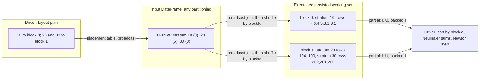

# 5. Distributed execution in Spark

[Tutorial home](README.md) · previous: [4. From mathematics to code](04-from-mathematics-to-code.md) ·
next: [6. Architecture and end-to-end flow](06-architecture-and-end-to-end-flow.md)

This chapter explains what happens when `CoxPH.fit` runs on a cluster: how rows are divided, what
each executor computes, what crosses the network, what the driver does, and which operations launch
Spark jobs or shuffles. The descriptions come from the source and are checked against the probe,
which ran the real engine in local Spark 4.1.0 with a listener recording every job, stage, task and
shuffle byte (local mode, one JVM; not a cluster).

## 5.1 Why the Cox fit is not trivially parallel

Many statistics are sums of independent row terms: split the rows anywhere, sum each piece, add the
pieces. The Cox log-likelihood is not of that form. Each event time needs S₀(t), S₁(t) and S₂(t) over
its risk set, and the risk set at t contains every row of the stratum that exits after t. Rows
therefore interact through time, within a stratum. Two facts rescue parallelism:

1. **Strata are independent given β.** ℓ, U and I are sums over strata of terms that only involve
   each stratum's own rows. Different strata can be computed anywhere, in any order.
2. **Within a stratum, one sorted sweep suffices** (chapter 4, section 4.3), so a stratum held in
   one place costs O(nₛ·p²) per pass.

pprof_spark's Cox layout, **StratumLocal**, follows directly: keep each stratum whole, pack strata into
blocks, sweep each block on an executor, and add the block results on the driver. Parallelism comes
from having many strata, which is the provider-profiling case (thousands of facilities). With a
single stratum there is a single block and a single task (section 5.9 and chapter 8).

## 5.2 The Spark vocabulary this chapter uses

| Term | Meaning here |
|---|---|
| Driver | The JVM running `CoxPH.fit`: planning, Newton, Cholesky, every p × p computation |
| Executor | A JVM that runs tasks; all row-level work happens here |
| Action | An operation that returns a result to the driver (`collect`, `count`); each one launches a **job** |
| Stage, task | A job runs stages separated by shuffles; a stage runs one task per partition |
| Shuffle (exchange) | Redistribution of rows across partitions by key, written to disk and read over the network |
| Persist | Keep a computed Dataset in executor memory (spilling to disk) so later jobs reuse it |
| Broadcast join | Joining a large Dataset with a small table copied to every executor, without shuffling the large one |
| Closure capture | Small driver values (β, the center) are serialized with the function sent to the tasks |

## 5.3 Logical blocks versus physical partitions

The engine separates two notions that Spark merges:

- A **logical block** is a set of whole strata, assigned by a deterministic plan computed on the
  driver from stratum sizes (chapter 4, C2). Blocks fix *what* is summed together and in *what order*.
- A **physical partition** is where Spark happens to put data. Partitions decide only *where* a block
  is computed.

Each block becomes a single record of a `Dataset[CoxBlock]`, holding its rows as primitive arrays in
canonical order. Results are summed per block, and blocks are combined in block-identifier order, so
nothing about Spark's partitioning, task scheduling or cluster size can reach the result (NN-4).

## 5.4 Building the working set: the one shuffle of row data

`CoxPH.withWorkingSet` validates the input, collects stratum sizes, plans the blocks and then builds
the working set ([CoxBlocks.scala lines 189–223](../../../engine/src/main/scala/pprof/spark/engine/cox/CoxBlocks.scala#L189-L223)).
The probe captured the physical plan of the persisted Dataset; simplified:

```text
InMemoryRelation  StorageLevel(disk, memory, deserialized)          <- persist(MEMORY_AND_DISK)
+- SerializeFromObject                                               <- CoxBlock records
   +- MapGroups CoxBlockBuilder.build                                <- sort rows, build arrays
      +- Sort [blockId]
         +- Exchange hashpartitioning(blockId, spark.sql.shuffle.partitions)   <- THE shuffle
            +- AppendColumns (blockId key)                           <- groupByKey
               +- Project
                  +- BroadcastHashJoin [stratum key]                 <- attach blockId, groupIndex
                     :- <scan of the validated input>
                     +- BroadcastExchange <- placement table (one row per stratum)
```

Every input row crosses the network exactly once, to the task that builds its block. Nothing in a
Newton iteration shuffles row data again (section 5.6).

## 5.5 A concrete example: three strata in two blocks

To see blocks form, the probe fitted a toy data set of 16 rows in three strata: tiny-ties as
stratum 10 (8 rows), a stratum 20 of 5 rows, and a stratum 30 of 3 rows, with
`BlockOptions(targetBlockBytes = 400)` to force small blocks.

**Planning on the driver.** With p = 1, T = ⌊400 / (8·(1 + 4))⌋ = 10 rows per block. No stratum
exceeds 10 rows, so all three share ⌈16/10⌉ = 2 blocks. Largest first, each to the least-loaded
block: stratum 10 (8 rows) → block 0; stratum 20 (5) → block 1, which is empty; stratum 30 (3) →
block 1, whose load of 5 is below block 0's 8. The plan the probe printed:

| Stratum key | Group index | Rows | Block |
|---:|---:|---:|---:|
| 10 | 0 | 8 | 0 |
| 20 | 1 | 5 | 1 |
| 30 | 2 | 3 | 1 |



Inside each block the rows are in canonical order: block 0 holds row ids 7, 6, 4, 5, 3, 2, 0, 1
(time 4 with the event first, then time 3, time 2, time 1); block 1 holds stratum 20 starting at
position 0 and stratum 30 starting at position 5 (`groupStart = 0, 5`).

**One evaluation at the converged β̂ = −0.370386.** Each block's task runs `CoxKernel.partial`, which
sweeps its strata in key order and returns one partial. The probe printed the per-stratum and
per-block contributions:

| | ℓ | U | I |
|---|---:|---:|---:|
| Stratum 10 (block 0) | −9.4279831316827440 | +0.45737167470972695 | 2.2803347509255345 |
| Stratum 20 | −3.6613991046312760 | +0.11025567447340878 | 0.96895773142182610 |
| Stratum 30 | −0.8699788373535310 | −0.56762734918314810 | 0.26832928032402680 |
| **Block 1 partial** (20 + 30) | −4.5313779419848070 | −0.45737167470973930 | 1.2372870117458530 |
| **Driver reduction** (block 0, then block 1) | −13.959361073667552 | −1.2e-14 | 3.5176217626713875 |

The two blocks' scores are +0.457 and −0.457. Neither block is at its own optimum; only their sum is
zero. That is why the fit cannot be split into independent per-block problems: every iteration
needs the global sums, and the Newton step is taken on the driver.

The same fit with the default block size puts all 16 rows in one block. The probe found the two
layouts' β̂ and ℓ bitwise identical here; the contract only promises agreement within T-part
(R1), because changing the grouping of strata changes the order of floating-point additions.

## 5.6 One evaluation pass

Each evaluation of (ℓ, U, I) at a β is one Spark job
([CoxPH.scala lines 445–465](../../../engine/src/main/scala/pprof/spark/engine/cox/CoxPH.scala#L445-L465)):

```scala
val b = beta.clone(); val c = prepared.center.clone()          // closure captures only these
val partials = prepared.workingSet.blocks
  .map((block: CoxBlock) => CoxKernel.partial(block, b, c, efron))(Encoders.product[CoxPartial])
  .collect()                                                     // B small records to the driver
  .sortBy(_.blockId)                                             // fixed order, not arrival order
```

The plan the probe captured has no exchange: an `InMemoryTableScan` of the persisted blocks,
`DeserializeToObject` into `CoxBlock` objects, `MapElements` running the kernel, and serialization of
the partials. The closure clones β and the center into local values so that it captures neither the
driver's mutable state nor the `Prepared` object, which holds a Dataset (§13: kernels capture only
local values).

**Data volume per pass.** Each block returns 1 + p + p(p+1)/2 doubles plus its identifier: 3 doubles
for p = 1, 66 for p = 10, 5,151 for p = 100. With B blocks, the driver receives about
8·B·(1 + p + p(p+1)/2) bytes per evaluation; chapter 8 turns this into sizing limits.

## 5.7 The iteration loop and the Spark jobs it launches

```mermaid
sequenceDiagram
  participant D as Driver: CoxPH.fit and Newton
  participant E as Executors
  D->>E: validation aggregate
  E-->>D: counts (one row)
  D->>E: groupBy(stratum).count
  E-->>D: m stratum sizes
  Note over D: LayoutPlan.create, driver-budget and maxStratumRows guards
  D->>E: broadcast placements, shuffle rows by blockId, build and persist blocks, count
  E-->>D: block count
  D->>E: summary pass
  E-->>D: B summaries: counts, column sums, fingerprints
  Note over D: center = column means
  loop beta = 0, then once per iteration and once per halving
    D->>E: map(CoxKernel.partial) with beta and center captured
    E-->>D: B partials (l, U, packed I)
    Note over D: sort, Neumaier sums, Cholesky, step, convergence test
  end
  Note over D: V = inverse of I, SE, z, p, intervals; CoxFit
  D->>E: unpersist the working set
```

The probe recorded these jobs for `CoxPH.fit` on tiny-ties with default options (Breslow, three
iterations), in a session configured like the test harness (`local[4]`, 4 shuffle partitions,
adaptive query execution on, ANSI on):

| Jobs | Purpose | Code | Tasks per job | Shuffle bytes |
|---|---|---|---|---|
| 0, 1, 2 | Validation aggregate; the distinct count of row identifiers adds two exchanges | [CoxInput.scala lines 69–70](../../../engine/src/main/scala/pprof/spark/engine/cox/CoxInput.scala#L69-L70) | 4, 1, 1 | 452 written, then 71 |
| 3, 4 | Stratum sizes | [GroupSizes.scala line 19](../../../engine/src/main/scala/pprof/spark/engine/layout/GroupSizes.scala#L19) | 4, 1 | 236 |
| 5 | Broadcast of the placement table | [CoxBlocks.scala lines 191–193](../../../engine/src/main/scala/pprof/spark/engine/cox/CoxBlocks.scala#L191-L193) | 1 (one per placement row, up to the default parallelism) | none |
| 6, 7 | Shuffle the rows by block identifier; build the blocks and fill the cache | [CoxBlocks.scala lines 207–214](../../../engine/src/main/scala/pprof/spark/engine/cox/CoxBlocks.scala#L207-L214) | 4, 4 | 433 |
| 8, 9 | `count()` of the cached blocks | [CoxBlocks.scala line 214](../../../engine/src/main/scala/pprof/spark/engine/cox/CoxBlocks.scala#L214) | 4, 1 | 227 |
| 10 | Summary pass | [CoxPH.scala lines 340–343](../../../engine/src/main/scala/pprof/spark/engine/cox/CoxPH.scala#L340-L343) | 4 | none |
| 11–14 | Evaluations at β = 0 and at the three iterates | [CoxPH.scala lines 450–453](../../../engine/src/main/scala/pprof/spark/engine/cox/CoxPH.scala#L450-L453) | 4 each | none |

The listener did not receive call sites (Spark leaves `callSite.short` out of job properties unless
the caller sets it), so the job-to-code mapping is inferred from the code and the order of jobs; it
was the same in every fit the probe ran. Evaluation jobs show one completed stage and one skipped:
the skipped stage is the build's shuffle, whose output Spark does not recompute because the blocks
are cached.

Three observations follow:

- **Fixed cost.** Eleven jobs run before the first evaluation, whatever n: ten to validate the
  input and build the working set, and the summary pass. Each job carries
  scheduling latency, which is why the project expects single-node pprof_py to be faster for data
  that fit on one machine (§3.7). Each further iteration costs exactly one job, and each halving one
  more.
- **No shuffle during the iterations.** Every evaluation job had zero shuffle bytes. The cost of an
  iteration is the compute of the sweep plus the collection of B partials.
- **Tasks per evaluation follow the build, not the blocks.** Every evaluation ran 4 tasks although
  tiny-ties is one block. The persisted Dataset keeps the partition count of the build's shuffle,
  `spark.sql.shuffle.partitions` at build time: the probe saw 1 task per evaluation with the setting
  at 1 and 7 tasks at 7. Adaptive query execution did not coalesce these partitions, consistent with
  Spark's default of not changing a cached plan's output partitioning (that setting was not
  inspected). Blocks are assigned to partitions by hashing the block identifier, so the bin-packing
  balances block *sizes* but not the load of *tasks* (review finding F-06, chapter 8).

## 5.8 Driver and executors

| Step | Driver | Executors |
|---|---|---|
| Validation | Schema check; reads one row of counts | Compute the counts |
| Stratum sizes | Reads m sizes (guarded) | Group and count |
| Planning | Bin packing; guards | — |
| Working set | Creates the placement table (m rows) | Join, shuffle, sort, build blocks, cache them |
| Summary | Checks counts; computes the center | One summary per block |
| Each evaluation | Sorts partials, Neumaier sums, Cholesky, step control | The sweep: all the O(n·p²) work |
| Inference | Inverse, standard errors, z, p, intervals | — |
| Robust variance | The sandwich | Score residuals; cluster sums (with shuffles) |
| Baseline, residuals | Fingerprint check; the stratum-key join | The sweeps; outputs stay distributed |

What reaches the driver, and why it is allowed to (NN-3: patient-level data never reach it):

| Collected | Size | Guard |
|---|---|---|
| Validation counts | One row, O(columns) | — |
| Stratum sizes | m rows | `maxGroupsOnDriver`, 2,000,000 |
| Block summaries | B records of p + 5 numbers | Bounded by the partial budget |
| Partials, every evaluation | B × (1 + p + p(p+1)/2) doubles | `driverBudgetBytes`, 64 MiB, checked when the plan is made |
| Robust partials | B (per row) or 256 (clustered) packed p × p matrices | — |
| Measures: per-time totals | Up to the number of distinct entry and exit times | `maxGroupsOnDriver` |

What goes the other way: the placement table, by broadcast join (m rows); β and the center, by
closure capture (2p doubles per task); for provider measures, the national baseline's arrays by
closure capture (K-scale). No Spark broadcast variables or accumulators are used: Spark Connect has
neither (§5.5).

## 5.9 Determinism and partition invariance

Results are bitwise identical for a fixed build, input and configuration, whatever the cluster size
or partitioning (R0), because:

1. the plan depends only on stratum sizes and keys, never on partitioning (C2);
2. rows inside a block are sorted by a total order on their contents, after normalizing negative
   zeros, so input order cannot leak in (C3);
3. each kernel is a deterministic function of its block, using `StrictMath`;
4. partials are combined in block-identifier order with Neumaier sums, never in arrival order, and
   never with Spark's floating-point aggregates (DIST-7);
5. the driver's linear algebra loops in a fixed order and uses no native BLAS.

Evidence: `CoxPHSuite` "R0: row order and partitioning leave every bit unchanged" (reversed rows,
`repartition(5)`), the R0 tests of the baseline and of clustered robust variance (`repartition(7)`),
and "R1: another block layout stays within T-part". Round 79's `CoxLayoutSuite` changes
`spark.sql.shuffle.partitions` too (1, 4 and 7, on reversed, repartitioned input, for fits with robust
variance and for baselines); before it only the probe did, refitting the two-block toy with the setting at 1 and
at 7 with reversed, repartitioned input, and found β̂, the covariance and ℓ bitwise identical to the
run at 4. Bitwise equality across platforms (JDK 17 and 21, Classic and Connect) is R2, checked by CI's
JDK matrix and its Spark Connect job.

## 5.10 Other distributed paths

| Call | Spark work | Shuffles of row-level data |
|---|---|---|
| `CoxPH.baseline(df, fit)` | Rebuilds the working set; one pass emitting per-stratum time rows; broadcast join of stratum keys; persist and count | One (the rebuild) |
| `CoxPH.residuals(df, fit)` | Rebuilds; one pass emitting one row per input row; persist and count | One (the rebuild) |
| Robust variance, per row (inside `fit`) | One more pass over the fit's working set; B partials | None |
| Robust variance, clustered (inside `fit`) | One pass emitting wᵢUᵢ per row; shuffle by cluster; shuffle of cluster sums into 256 buckets | Two: n p-vectors, then one per cluster |
| `CoxMeasures.standardized` | A provider layout (the fit's if the provider is the stratum, else a new one plus a fingerprint check through the fit's layout, OI-46); a max-η pass; per-time totals shuffled by time; national baseline on the driver; one provider pass | One or two rebuilds, plus the per-time shuffle of at most B·K small rows |
| `CoxProviderTests.test` | Calls `standardized`, then row-wise tests on the provider table | As `standardized` |
| `CoxPrediction.cumulativeHazard`, `survival` | Validation aggregate; a left-anti join counting unknown strata; union with the baseline and a window partitioned by stratum | One, by stratum (all rows of a stratum in one task, OI-43) |
| `CoxJob` | Calls each of the above that the run specification asks for | Each call rebuilds its own working set (review finding F-05) |

Every entry point that takes the training data rebuilds the working set from scratch, because a
fitted model deliberately holds no reference to the training DataFrame (ARCH-4) and each call
verifies the data's fingerprint (API-3). The probe observed this directly: a call to `evaluateAt`
after an explicit `withWorkingSet` repeated all eleven preparation jobs.

## 5.11 Spark Connect

The engine compiles against `spark-sql-api` only and uses the Dataset API shared by Classic Spark and
Spark Connect: no RDDs, `SparkContext`, broadcast variables or accumulators (ARCH-2, enforced by
`scripts/check-engine-api.sh`). Small values travel in closures and tables travel by broadcast join,
both of which Connect supports. CI runs the engine suites through a Spark Connect client (T8). The
Python wrappers are Classic only; Connect users run `CoxJob`.
