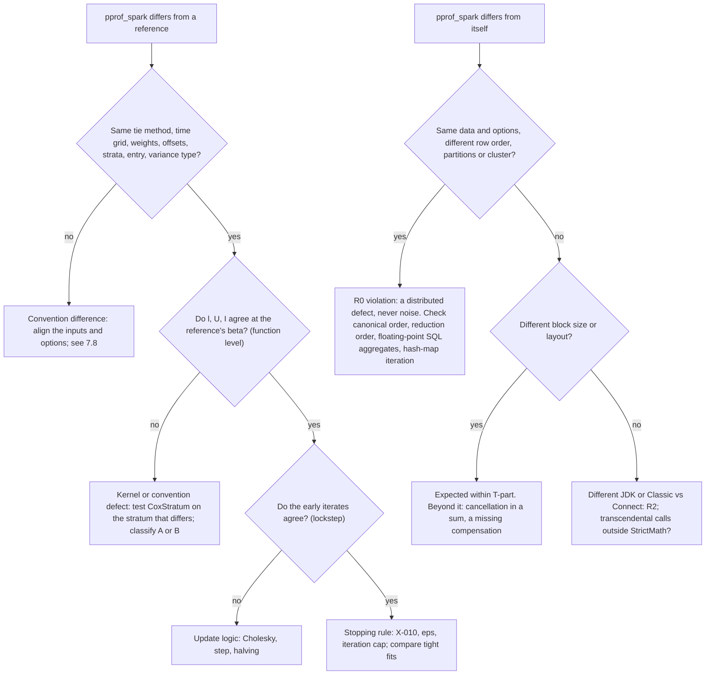

# 7. Validation, testing and numerical accuracy

[Tutorial home](README.md) · previous: [6. Architecture and end-to-end flow](06-architecture-and-end-to-end-flow.md) ·
next: [8. Performance and limitations](08-performance-and-limitations.md)

This chapter explains how confidence in the Cox implementation is established, what the evidence
does and does not show, why two correct implementations can still differ, and how to tell a
statistical discrepancy from a distributed-computing defect or an ordinary bug.

## 7.1 Kinds of evidence

| Evidence | What it establishes | Where |
|---|---|---|
| Kernel unit tests (T1, T2) | Formulas against closed forms and finite differences, without Spark | `CoxStratumSuite`, `NewtonSuite`, `CholeskySuite`, `SummationSuite` |
| Engine suites in local Spark (T3 to T7) | Parity with reference fixtures, invariances, edge cases, schemas and persistence through the real distributed code | `engine/src/test/.../cox/*Suite.scala` |
| The same suites through Spark Connect (T8) | The engine behaves identically under Connect | CI's Connect job |
| Fixtures and their calibration | pprof_py and R agree with each other within each tolerance class; deliberately wrong answers miss by at least 10× | [cox-calibration.md](../../parity/cox-calibration.md) |
| CI runs | The suites pass on JDK 17 and 21 | As recorded by the maintainer in STATUS.md and HANDOFF.md |
| The tutorial probe | The worked numbers and Spark job traces of this tutorial | Sandbox only (README) |
| Not yet available | Multi-node clusters (T9), scale and performance (T10), production data (T12) | Deferred to the maintainer's package-level Databricks run (D-28) |

## 7.2 Reference fixtures

The six Cox fixtures ([fixtures/cox/](../../../fixtures/cox/)) are synthetic and exact in text:
integer times, covariates on a 1/64 grid, offsets on a 1/16 grid and weights on a 1/2 grid, so every
implementation reads identical doubles (ADR-0005).

| Case | Rows | Events | p | Strata | Weights | Offsets | Truncation |
|---|---:|---:|---:|---:|---|---|---|
| tiny-ties | 8 | 6 | 1 | 1 | — | — | — |
| rc-unstratified | 400 | 304 | 3 | 1 | — | — | — |
| rc-stratified | 600 | 412 | 3 | 25 | — | — | — |
| rc-stratified-weights-offset | 600 | 434 | 3 | 25 | yes | yes | — |
| lt-stratified | 600 | 392 | 3 | 10 | — | — | yes |
| lt-weights-offset | 600 | 385 | 3 | 10 | yes | yes | yes |

`reference/fixtures/generate.py` runs pprof_py v0.7.0 at commit `9320766`;
[`cox_survival.R`](../../../reference/fixtures/cox_survival.R) runs R 4.3.3 with survival 3.5-8. For
both tie methods, R produces default fits and tight fits (`eps = 1e-11`, `iter.max = 100`) with
`robust = FALSE` (X-009); function-level values at β = 0 and at a fixed β through
`coxph(init = β, control = coxph.control(iter.max = 0))`; `basehaz(fit, centered = FALSE)`;
martingale, score and dfbeta residuals; and robust variances per row (`cluster = id`) and clustered
(`cluster = id %% 40`). Every double is stored as a hexadecimal string, which parses back bit for bit
in Python, R and Java. `fixtures/manifest.json` records versions, options and checksums, which
`FixturesSuite` checks on every CI run.

## 7.3 Tolerance classes

Tolerances live in `testkit/src/main/resources/tolerances.conf`, and tests name a class, never a
number. Element i passes when |aᵢ − eᵢ| ≤ atol + rtol·max(|eᵢ|, s), with s the largest magnitude in
the expected quantity (D-09). Changing a tolerance needs a written justification, a negative control
and the maintainer's approval (NN-9).

| Class | Compares | Default |
|---|---|---|
| T-fn | ℓ, U, I at fixed parameters | 1e-12 relative |
| T-iter | Lockstep iterates | 1e-10 |
| T-coef | Converged coefficients | atol 1e-10, rtol 1e-8 |
| T-var | Standard errors, covariance | 1e-7 |
| T-base | Baseline hazard, survival, predictions | 1e-8 |
| T-res | Residuals | 1e-9 (absolute, scaled) |
| T-meas | Expected counts and ratios | 1e-8 |
| T-test | Test statistics | 1e-8 |
| T-p | p-values: log₁₀ compared below 1e-10 | absolute 1e-6 in log₁₀ |
| T-part | Layout and platform invariance | 1e-12 objective, 1e-10 parameters |

## 7.4 Three levels of parity

| Level | What is compared | Why | Cox tests in `CoxPHSuite` |
|---|---|---|---|
| Function | ℓ, U, I at β = 0 and at a fixed β, against pprof_py and R | No optimizer is involved, so it isolates the kernel and the conventions; the strongest test | "function-level parity at beta = 0 and the fixed beta, both tie methods (T-fn)", all six fixtures |
| Lockstep | The iterates before the final one, from β = 0, against pprof_py's | Isolates the update rule from the stopping rule | "lockstep: iterates before the final one match pprof_py's (T-iter)" |
| End to end | Tight fits against both references: coefficients, standard errors, covariance, information, ℓ(β̂), ℓ(0); default fits stop at pprof_py's iteration count, within T-coef of its estimates; Wald statistics, p-values and intervals | The whole pipeline | "tight fits match pprof_py and R", "default fits stop where pprof_py stops", "Wald statistics, p-values and intervals" |

Negative controls run alongside: the other tie method's estimates and those of a data set with one
tied time shifted by a day must differ from pprof_spark's by more than ten times T-coef ("negative
controls: the other tie method and shifted ties lie outside T-coef"). A test that cannot fail proves
nothing; the controls show these can.

The other Cox suites apply the same pattern to later features: `CoxBaselineSuite` (baseline and
predictions, T-base), `CoxResidualsSuite` (T-res), `CoxRobustSuite` (T-var), `CoxMeasuresSuite` and
`CoxProviderTestsSuite` (T-meas, T-test, T-p), `CoxFitIOSuite` (bitwise persistence), and
`CoxJobSuite` (the job's outputs equal the library's bit for bit). Downstream quantities are
compared at the reference's own estimates, so that X-010 does not leak into them.

## 7.5 What the calibration shows

In [cox-calibration.md](../../parity/cox-calibration.md), pprof_py and R agree within every class for
every quantity, and the weakest negative control misses by a factor of 509 or more. One entry
deserves attention: tiny-ties with Breslow ties, where pprof_py and R differ by **0.995** of T-coef.
That difference is X-010's half step (chapter 3, section 3.4). pprof_spark follows R's order and sits
1.2e-7 of the tolerance from R, but its comparisons with pprof_py's tight and default estimates on
that case use 0.995 of the budget: they pass, narrowly, and for a reason that is understood (review
finding F-11).

## 7.6 Invariance, edge-case and reproducibility tests

| Test (`CoxPHSuite` unless noted) | What it shows |
|---|---|
| Monotone time maps, scaling and translation | ℓ and β̂ bitwise unchanged under time² + 5; β̂ divided by 4 when x1 is multiplied by 4; unchanged when x2 is shifted |
| Weights scaled by 3; an offset proportional to a covariate | β̂ unchanged and SE divided by √3; β̂₁ lowered by exactly 0.5 |
| A zero weight equals dropping the row (X-013) | Both tie methods |
| Under Breslow, weight 2 equals a duplicated row | Frequency-weight semantics |
| Entry column of zeros | Bitwise equal to the right-censored fit |
| Splitting (a, b] at c | Fit unchanged under T-coef and T-fn |
| Shifting every entry and exit time, below zero | Bitwise unchanged |
| Invalid inputs; no events; aliasing; strata without events; iteration cap; `maxStratumRows` | Exact failure behavior and messages |
| Canonical order of a hand-built block | Order and negative-zero normalization |
| R0: reversed rows and `repartition(5)` | Every bit of β̂, covariance, ℓ and the fingerprint unchanged |
| R1: `targetBlockBytes = 2048` | More blocks; β̂ and ℓ within T-part |
| `CoxStratumSuite`: finite differences, closed forms, truncated risk sets | The kernel's derivatives are the derivatives of its objective |

## 7.7 What has been demonstrated, and what has not

Demonstrated in CI, as reported by the maintainer: agreement with R and pprof_py for every quantity
above on six small fixtures under both tie methods; the invariances and edge cases above; bitwise
reproducibility across row orders and input partitionings on one fixture per feature; one layout
change within T-part; agreement across JDK 17 and 21 and between Classic Spark and Spark Connect.

**Not demonstrated** at `efb6329`:

| Gap | Why it matters |
|---|---|
| Scale, performance and the crossover with pprof_py (PERF-1) | No Cox benchmark exists; the scale test waits for the package-level run (D-28) |
| Multi-node clusters (T9) | Local mode shares one JVM between driver and executors, hiding serialization paths and driver-only state (§9.6) |
| Multi-block reduction in the parity tests | At the default 4 MiB target a block holds 74,898 rows when p = 3, so every fixture is one block; only the R1 test splits a fixture into several, and checks β̂ and ℓ within T-part |
| `spark.sql.shuffle.partitions` | No test varies it; the probe did (bitwise equal at 1, 4 and 7) |
| Skewed stratum sizes, oversized strata, realistic `maxStratumRows` sizes | §9.6 asks every engine test for a skewed distribution; the Cox suites have none |
| Larger p, badly scaled covariates, extreme offsets, monotone likelihood | p ≤ 3 in every fixture; chapter 3 shows these fail or mislead |
| Near-tied times | Behavior differs from R's default by design; untested |
| Heavy truncation | The compensated removals are tested on 600-row fixtures only |

## 7.8 Why two correct implementations differ

| Source | Typical size | How the project treats it |
|---|---|---|
| Tie method | Large: beyond T-coef by orders of magnitude | A convention; references always set it explicitly |
| R's near-tie merging (`timefix`) | Large when times are not integers | Fixtures use integer times; pprof_spark compares exactly |
| Step-control order (X-010) | Half a final Newton step, up to about 1e-8 relative | B, corrected to R's order; pprof_py comparisons within T-coef |
| Stopping tolerance and iteration cap | Up to the size of a final step | Tight settings for converged comparisons |
| Order of additions: canonical order, compensated sums, block grouping | 1e-16 to 1e-14 relative | D, numerical noise within T-fn and T-part |
| Cholesky against pprof_py's LU solve | About 1e-16 relative | D |
| `StrictMath` against another math library | At most one unit in the last place per call | D |
| R's robust default with non-integer weights (X-009) | Large | Fixtures call R with `robust = FALSE` |
| Baseline reference point (X-014) | A factor exp(mean offset) | C, documented |
| pprof_py's counting-process Breslow robust variance (X-015) | Up to 11% | B, corrected |
| Zero-weight tied events under Efron (X-013) | 0.67% on tiny-ties | B, corrected |
| Distributed aggregation order | Zero: fixed by design | Any difference is a defect |

## 7.9 Statistical discrepancy, distributed defect, or bug?

In practice:

1. **Check conventions first.** Most reported differences from R are the tie method, `timefix`, R's
   robust default for non-integer weights, or the baseline reference point.
2. **Compare at a fixed β.** In R, `coxph(..., init = beta, control = coxph.control(iter.max = 0))`
   gives ℓ at β, its score through the score residuals, and its information through `solve(fit$var)`,
   exactly as `cox_survival.R` does. In pprof_spark, `CoxPH.evaluateAt` (package-private, callable
   from tests) gives (ℓ, U, I) at any β with the full distributed path. Agreement here rules out the
   kernel; disagreement rules out the optimizer.
3. **A difference between runs of pprof_spark itself is never noise.** Bitwise reproducibility
   (R0) is a contract; a violation is a defect in ordering or reduction.
4. **Classify before merging** (§3.5): A, a pprof_spark defect; B, a reference defect; C, an
   intentional divergence; D, numerical noise within its class; E, a documentation mismatch.

## 7.10 Recommended additional tests

These are proposals; review finding F-07 collects them.

| Test | Layer | What it would show |
|---|---|---|
| Function-level and end-to-end parity rerun with `targetBlockBytes` of about 2 KiB on every stratified fixture | T4 | The multi-block reduction path at parity, not only within T-part of itself |
| R0 with `spark.sql.shuffle.partitions` at 1, 4 and 7 | T3 | What the probe showed, as a test |
| A generated data set with heavy-tailed stratum sizes and one oversized stratum | T3, T5 | Plan properties (largest first, no empty block, dedicated blocks) and R0, R1 under skew |
| The six-row monotone-likelihood data set | T6 | The status and warning chosen once a detection rule is specified |
| Offsets of ±710 and covariates scaled by 10⁶ | T6 | Documented behavior, or success after the fix proposed in F-03 |
| A synthetic p = 50 fit through the engine, multi-block, against finite differences of ℓ | T3 | Correctness and cost of the packed p² paths beyond p = 3 |
| Heavily truncated data checked against a test-only direct risk-set computation | T2 | The accuracy of the compensated removals when the risk set becomes small |
| Times that differ only in their last bits | T6 | That they are not merged, as specified |
