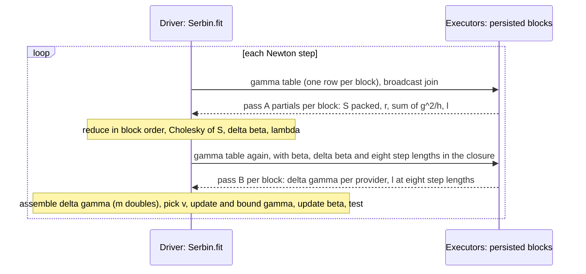

# 6. Distributed execution and the end-to-end flow

[Tutorial home](README.md) · previous: [5. Standardized measures](05-standardized-measures.md) ·
next: [7. Validation](07-validation-and-numerical-accuracy.md)

This chapter follows a logistic fit through Spark: the layout, every Spark job of a fit as the probe
recorded it, what crosses the network, what the driver holds, and why the results do not depend on the
cluster. The machinery shared with Cox — validation, bin packing, the one shuffle that builds the
persisted working set, ordered reduction — is explained in the Cox tutorial's
[chapter 5](../cox/05-distributed-execution.md); this chapter concentrates on what is different.

## 6.1 The ProviderLocal layout

Strata were the unit of parallelism for Cox; here it is the provider. The fit collects provider sizes,
screens out providers with at most 10 records on the driver, and packs whole providers into logical
blocks with the same `LayoutPlan` as Cox: providers larger than the target get blocks of their own, the
others fill shared blocks largest first, each into the least-loaded block. The target is
⌊4 MiB / (8·(p + 4))⌋ = 74,898 rows for p = 3, so the 1,075 rows of `lfe-base` form one block. Inside a
block the rows are sorted by provider, row identifier, covariates, events and trials, after negative
zeros are normalized ([LogisticBlocks.scala lines 101–171](../../../engine/src/main/scala/pprof/spark/engine/logistic/LogisticBlocks.scala#L101-L171)).
A `LogisticBlock` carries the rows as primitive arrays and a `gamma` array that is empty in the
persisted working set: provider effects change every step, so they travel separately.

## 6.2 The end-to-end flow of `LogisticFE.fit`

| # | Step | Where | Code (engine LogisticFE.scala) |
|---:|---|---|---|
| 1 | Validate inputs; one aggregation job | Driver and executors | [line 67](../../../engine/src/main/scala/pprof/spark/engine/logistic/LogisticFE.scala#L67) |
| 2 | Collect provider sizes; screen; guard `maxProvidersOnDriver` | Executors, then driver | [lines 69–81](../../../engine/src/main/scala/pprof/spark/engine/logistic/LogisticFE.scala#L69-L81) |
| 3 | Plan blocks; guard the driver budget for partials | Driver | [lines 82–95](../../../engine/src/main/scala/pprof/spark/engine/logistic/LogisticFE.scala#L82-L95) |
| 4 | Build and persist the working set (the one row shuffle) | Executors | [line 96](../../../engine/src/main/scala/pprof/spark/engine/logistic/LogisticFE.scala#L96) |
| 5 | Summary pass: counts, Σnx, co-moments for the correlation warning, fingerprint | Executors, then driver | [lines 98–137](../../../engine/src/main/scala/pprof/spark/engine/logistic/LogisticFE.scala#L98-L137) |
| 6 | SerBIN from γ = logit(ȳ), β = 0; two passes per Newton step | Driver loop, executor passes | [lines 138–151](../../../engine/src/main/scala/pprof/spark/engine/logistic/LogisticFE.scala#L138-L151) |
| 7 | Variances: S at the estimates (with ℓ), then the provider variances | Two passes | [lines 154–191](../../../engine/src/main/scala/pprof/spark/engine/logistic/LogisticFE.scala#L154-L191) |
| 8 | Robust variances when a cluster column is given | Two passes | [lines 192–227](../../../engine/src/main/scala/pprof/spark/engine/logistic/LogisticFE.scala#L192-L227) |
| 9 | AUC for 0/1 outcomes | One sort | [lines 228–230](../../../engine/src/main/scala/pprof/spark/engine/logistic/LogisticFE.scala#L228-L230) |
| 10 | Flags, coefficient table, warnings, `LogisticFit` | Driver | [lines 231–309](../../../engine/src/main/scala/pprof/spark/engine/logistic/LogisticFE.scala#L231-L309) |
| 11 | Release the working set | Driver | [line 310](../../../engine/src/main/scala/pprof/spark/engine/logistic/LogisticFE.scala#L310) |

## 6.3 Shipping γ: a table joined with a broadcast hint

Every pass needs each block's provider effects. `SparkPasses.withGamma` builds, on the driver, a
DataFrame with one row per block holding that block's effects, and joins it to the persisted blocks
with a broadcast hint ([lines 780–787](../../../engine/src/main/scala/pprof/spark/engine/logistic/LogisticFE.scala#L780-L787)).
This is the project's pattern for O(m) parameters (§6.7): a broadcast-joined table rather than a
broadcast variable, which Spark Connect does not have. Pass B returns Δγ, which the driver places into
the m-vector by provider index; the driver applies the step and the bound and ships the new γ with the
next pass. So γ lives on the driver for the whole fit, which is why `maxProvidersOnDriver` (10⁷)
guards m; a distributed γ is OI-50.

## 6.4 The Spark jobs of a fit

The probe ran `LogisticFE.fit` on `lfe-base` in local Spark (`local[4]`, 4 shuffle partitions,
adaptive query execution and ANSI on, as the test harness), with a listener recording every job:

| Jobs | What | Tasks | Shuffle |
|---|---|---|---|
| 0–2 | Validation aggregate, with the distinct count of row identifiers | 4, 1, 1 | 34 KB of row identifiers |
| 3–4 | Provider sizes | 4, 1 | 1.1 KB |
| 5 | Broadcast of the placement table (30 providers) | 4 | — |
| 6–9 | Build the blocks (the row shuffle) and materialize them | 4, 4, 4, 1 | 23.6 KB, then 0.2 KB |
| 10 | Summary pass | 4 | — |
| 11–30 | 10 Newton passes (5 steps, every full step accepted): each a small job broadcasting the γ table, then the pass | 1 and 4, alternating | — |
| 31–34 | Variance passes (S at the estimates, provider variances), each with its broadcast job | 1 and 4 | — |
| 35–39 | AUC: the effects' broadcast, the pass, and the sort by π | — | 11 KB |

Forty jobs in all; with four blocks (`targetBlockBytes` = 16,800, 300 rows per block), 39, and the
broadcast jobs then ran four tasks, one per block row. Three things stand out:

- **Two jobs per pass.** Each pass launches a job to broadcast the γ table and then the pass itself, so
  a Newton step whose full step is accepted costs four jobs; a rejected ladder of eight step lengths
  costs two more.
- **No row shuffle after preparation.** The passes read the persisted blocks; only the AUC's sort
  shuffles again, a few bytes per record.
- **Task counts follow the build's shuffle partitions**, as for Cox, not the number of blocks.

## 6.5 What crosses the network, and what the driver holds

| Per Newton step | Size |
|---|---|
| γ to the executors, twice | 2 × 8m bytes, as B table rows |
| Pass A partials to the driver | B × (p(p+1)/2 + p + 2) doubles: 11 for p = 3 |
| Pass B to the driver | Δγ (8m bytes) and 8 log-likelihoods per block |
| On the driver | γ and Δγ (m doubles each), the median (a sort of m values), the p × p solve |

At m = 10⁶ providers that is about 24 MB of provider effects through the driver per step, which is the
design's main cost beyond the passes themselves; the specification accepted it (§11) with the guard
and OI-50 as the escape.

## 6.6 Determinism

Rows are in canonical order; every provider sum is a Neumaier sum in that order; block partials are
reduced in block order; Δγ is placed by provider index; the median is exact; and the eight trial
log-likelihoods use the same arithmetic as a sequential search. The probe confirmed bitwise
reproducibility (R0) at `spark.sql.shuffle.partitions` 1, 4 and 7 with reversed, repartitioned input,
and found that four blocks gave β̂ and ℓ bitwise equal to one block and γ̂ within 1.4e-16 (R1 requires
only T-part). `LogisticBehaviourSuite` tests R0 (reversed rows, `repartition(7)`) and R1 (`targetBlockBytes` = 4,096),
and since round 79 `LogisticLayoutSuite` adds R0 across shuffle partitions and many-block parity with
pprof_py on every fixture.

## 6.7 After the fit

| Call | Spark work |
|---|---|
| `covariateTests` | Rebuild the working set with the fit's plan and check the fingerprint; per tested covariate, a reduced copy of the blocks, a complete SerBIN refit, and one more pass |
| `LogisticProviderTests.test` | Rebuild and check (nine jobs), broadcast the effects, one pass, then the m result rows through the driver and a sort (15 jobs observed) |
| `LogisticStandardization` | Rebuild and check; an indirect pass; for direct measures, a pass for bin moments, a shuffle by bin, and a pass over providers in chunks |
| `predict` | A broadcast join of the effects (m rows) and column expressions; no rebuild |
| `LogisticJob` | Each requested output, in turn |

Every call that needs the training data rebuilds the working set, as for Cox (review finding L-04).
